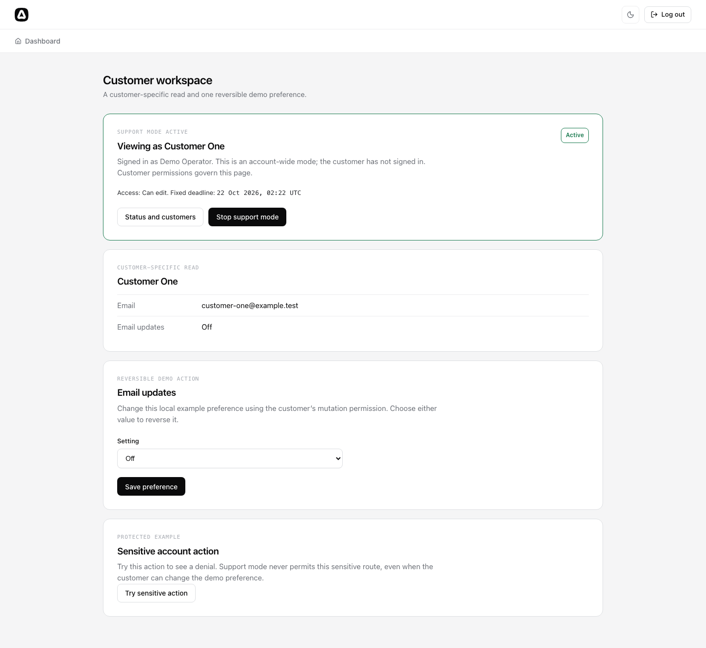

# Masquerade for AdonisJS

[](https://github.com/Kevinjohn/oss-adonisjs-impersonate/actions/workflows/checks.yml)
[](LICENSE.md)
[](package.json)
[](https://adonisjs.com)

**See exactly what your customer sees, without their password.**

A customer reports that a page looks wrong. Your support team can't reproduce it from their own
account, and asking for the customer's password is not an option. Masquerade lets an authorized
operator open the application as that customer, for a fixed time, while staying signed in as
themselves.



## What you get

- **The operator stays the operator.** Login, logout and support controls keep using your
  existing session guard. The customer never signs in and no customer credential is created.
- **Your existing authorization still decides.** On business routes, `auth.user` is the customer,
  so your normal Auth and Bouncer checks apply. Operator and customer permissions are never
  combined.
- **View-only by default.** Edit is chosen at start and only when your `canEdit` policy allows it.
  Routes you mark `sensitive()` are always blocked during support mode.
- **Time-boxed and stoppable.** Every mode has a fixed deadline (15 minutes by default, one hour
  maximum) and an explicit stop.
- **Sessions and access tokens.** Works with native AdonisJS sessions and opaque access tokens.

## Quick win

After [setup](docs/guide/setup.md), choosing what support mode can do is a route change. Put
business routes on the effective guard, and mark the ones that need care:

```ts
import { allowMutation, sensitive } from 'adonisjs-masquerade/http'
import { middleware } from '#start/kernel'
import router from '@adonisjs/core/services/router'

router
  .get('/support/customer', [() => import('#controllers/demo_controller'), 'customer'])
  .as('demo.customer')
  .use(middleware.auth({ guards: ['web_effective'] }))

router
  .post('/support/customer/preference', [
    () => import('#controllers/demo_controller'),
    'preference',
  ])
  .as('demo.preference')
  .use(allowMutation())
  .use(middleware.auth({ guards: ['web_effective'] }))

router
  .post('/support/customer/sensitive', [() => import('#controllers/demo_controller'), 'sensitive'])
  .as('demo.sensitive')
  .use(sensitive())
  .use(middleware.auth({ guards: ['web_effective'] }))
```

- The first route is readable as the customer.
- The second can be changed as the customer, when the mode was started with edit access.
- The third is rejected before its handler runs whenever support mode is active.

## Try it

With Node 24 and pnpm, run the fictional demo from this checkout:

```sh
nvm use
pnpm demo
```

Open <http://127.0.0.1:3333> and sign in with the fictional operator account listed in the
[demo instructions](examples/native-session/README.md#one-command-demo). The
[walkthrough](docs/guide/walkthrough.md) follows the same support journey with screenshots.

## Status

Early alpha for local self-testing. Version `0.0.0` is not published to a registry; install from a
local build as described in the [setup guide](docs/guide/setup.md#generate-the-starter-files).

## Documentation

- [Getting started](docs/guide/getting-started.md): choose the demo or integrate an existing app.
- [Install and configure](docs/guide/setup.md) and [use a support mode](docs/guide/usage.md).
- Clients: [JSON](docs/guide/clients/json.md), [Inertia React](docs/guide/clients/react.md),
  [Inertia Vue](docs/guide/clients/vue.md), [access tokens](docs/guide/access-tokens.md).
- [Security boundaries](docs/guide/security.md) and [troubleshooting](docs/guide/troubleshooting.md).
- [Documentation index](docs/README.md) and [API reference](docs/api-reference.md).

Contributing: [CONTRIBUTING.md](CONTRIBUTING.md) and [SECURITY.md](SECURITY.md). Scope and design
contract: [DEVELOPMENT-PLAN.md](DEVELOPMENT-PLAN.md), [SPEC-impersonation.md](SPEC-impersonation.md),
[PRD-impersonation.md](PRD-impersonation.md).
